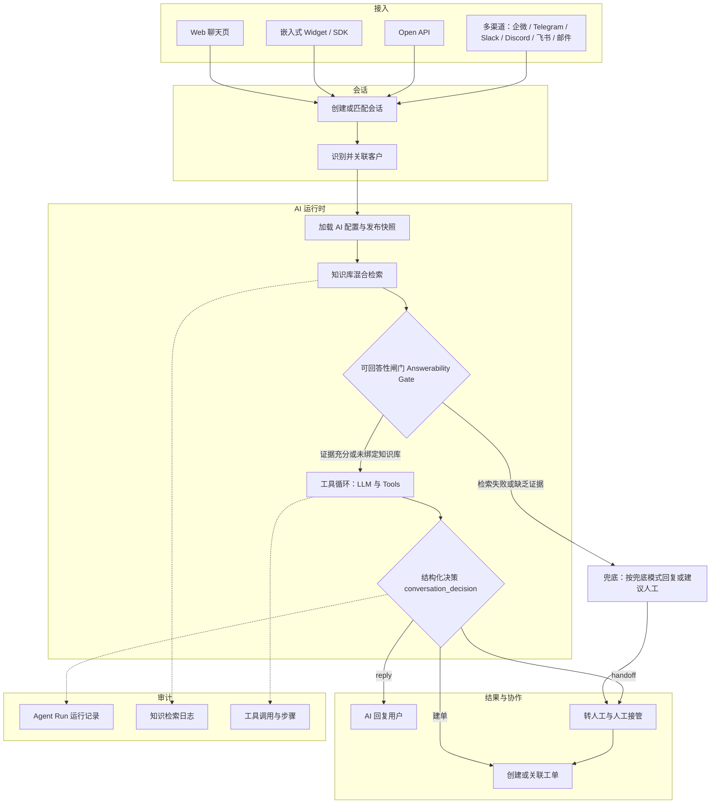
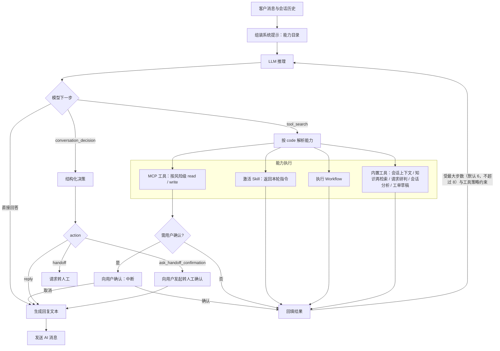
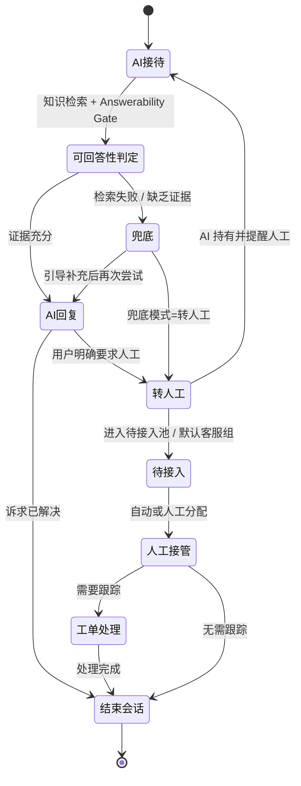

# 客服Agent

AI Agent 客服系统，把知识库问答、人工接管、工单闭环与私有化部署集于一体。

> 为同时承担在线咨询、知识库问答、人工协作与服务跟踪的团队而生。它并非简单地把 LLM 塞进聊天框，而是围绕真实客服场景打造的 AI Helpdesk 基础底座。

## 产品预览

客户侧咨询、客服工作台、知识库、模型配置与 AI Agent 编排，全部收拢在同一套系统内。

### 客户侧在线咨询

客户可直接在 Web 聊天页发起咨询：由 AI Agent 先行接待，并依据知识库作答；一旦用户明确要求人工介入，即进入转人工确认流程。

### 客服工作台

客服工作台将会话列表、消息处理、AI 转人工、客服回复、会话标签、关联客户与工单信息查看集中于一处，贴合客服的日常接待场景。

### 知识库与 AI 配置

知识库用来沉淀 FAQ、文档与可检索内容；AI Agent 则可绑定模型配置、知识库、Skills 与工具能力，拼装出面向具体客服场景的智能客服实例。

### 模型配置

模型配置走 OpenAI-compatible 接入方式，大语言模型、向量模型与重排模型可分别设置，并统一管理上下文、输出、超时、重试及启用状态。

## 为什么选择它

- **AI 先接待**：由 AI Agent 优先承接常见问题、标准流程与知识库问答。
- **知识约束回答**：借助 RAG 与 Answerability Gate 判定知识片段是否足以作答，收敛超出知识库范围的乱答。
- **自然转人工**：当知识库不足以支撑、用户明确提出，或流程需要人工确认时，顺畅切入人工接管。
- **会话到工单闭环**：在线会话、客服接待、工单创建、状态流转与处理记录，在同一套系统内形成闭环。
- **适合二次开发**：后端 Go、前端 Next.js，兼容 Skills、MCP 与 OpenAI-compatible 模型接入，便于二次开发。
- **可私有化部署**：支持 SQLite / MySQL 与 Qdrant，兼顾本地体验、内网部署与企业自托管。

## 核心能力

- **AI Agent 客服**：由 AI 优先回复，覆盖兜底、确认、工具调用与人工协同。
- **在线会话系统**：访客会话、消息收发、未读状态、会话分配、转接与关闭一应俱全。
- **客服工作台**：客服可接管会话、回复用户、转接同事、关联客户并创建工单。
- **知识库 RAG**：覆盖知识库、文档、FAQ、切片、向量检索、检索日志与质量分析。
- **Answerability Gate**：先判定检索内容能否支撑作答，不足时回以兜底提示并引导联系人工。
- **工单系统**：可从会话创建工单，并完成分类、指派、状态流转、进展记录与闭环。
- **客服组织管理**：提供客服档案、客服组、排班与自动分配能力。
- **AI 扩展能力**：涵盖 Skills、MCP 调试与外部工具接入。
- **多入口接入**：同时提供管理后台、客服工作台、客户侧 Web 页面与嵌入式 SDK。

## 适用场景

- 官网在线答疑
- SaaS 产品客户支持
- AI 与人工混合接待
- 企业内部服务台
- 售后、报障、投诉与运营支持
- 依赖知识库问答与人工协作的客服团队

## 快速开始

建议先用 Docker Compose 拉起完整服务体验：

```bash
docker compose up -d --build
```

部署、嵌入组件与模型供应商配置可参见下文，以及 `config/`、`docker/` 下的配置文件。

Compose 默认拉起以下服务：

- `cs-agent`：应用服务，端口 `8081`
- `mysql`：MySQL 8.4，数据卷 `mysql-data`
- `qdrant`：向量数据库，数据卷 `qdrant-data`，端口 `6333` / `6334`

启动完成后可访问：

- 管理后台：`http://localhost:8081/dashboard`
- 客服工作台：`http://localhost:8081/dashboard/conversations`
- 客户侧 Web 接入示例：`http://localhost:8081/support/demo`
- 客户侧聊天页：`http://localhost:8081/support/chat`

默认管理员凭据：

- 用户名：`admin`
- 密码：`123456`

> 在面向公网或团队环境首次上线前，请务必更换默认管理员密码，并为鉴权、会话与模型分别配置独立密钥。

## 本地开发

### 环境要求

- Go `1.26+`
- Node.js `20+`
- `pnpm`
- Qdrant

### 准备配置

```bash
cp config/config.example.yaml config/config.yaml
```

默认配置采用：

- SQLite：`data/app.db`
- Backend：`http://127.0.0.1:8081`
- Qdrant gRPC：`127.0.0.1:6334`

若本地尚无 Qdrant，可用 Docker 启动：

```bash
docker run -p 6333:6333 -p 6334:6334 qdrant/qdrant
```

安装前端依赖：

```bash
cd web
pnpm install
cd ..
```

一并启动后端与前端开发服务：

```bash
task dev
```

开发环境默认入口如下：

- 管理后台：`http://localhost:3000/dashboard`
- 客服工作台：`http://localhost:3000/dashboard/conversations`
- 客户侧 Web 接入示例：`http://localhost:3000/support/demo`
- 客户侧聊天页：`http://localhost:3000/support/chat`

## 技术栈

- Backend：Golang + Gin + GORM + `github.com/mlogclub/simple`
- Frontend：Next.js 16 + React 19 + shadcn/ui + Tailwind CSS
- Database：SQLite / MySQL
- Vector DB：Qdrant
- AI：OpenAI-compatible LLM / Embedding + RAG + Skills + MCP

## 项目结构

```text
.
├── cmd/                    # server / migration / generator / testdata
├── internal/
│   ├── bootstrap/          # 启动、路由、数据库和迁移初始化
│   ├── builders/           # model / 聚合结果到 response DTO 的映射
│   ├── handlers/           # dashboard / api / third HTTP handlers
│   ├── middleware/         # Gin middleware
│   ├── migration/          # 幂等数据迁移
│   ├── models/             # GORM models
│   ├── repositories/       # 数据访问层
│   ├── services/           # 业务编排和事务边界
│   ├── ai/                 # LLM / RAG / Runtime / Skills / MCP
│   └── pkg/                # config / dto / enums / httpx / utils 等基础包
├── web/                    # Next.js 前端工程
│   ├── app/dashboard/      # 管理后台与客服工作台
│   ├── app/support/        # 客户侧接入和聊天页面
│   ├── components/         # React 组件
│   ├── lib/                # API client、SDK 源码和工具函数
│   └── public/sdk/         # 构建后的嵌入式 SDK
├── config/                 # 配置文件
├── docker/                 # Docker 配置
└── docs/                   # 项目文档
```

## 常用命令

```bash
task dev            # 同时启动后端和前端开发服务
task build          # 构建前端 SPA 和当前平台 Go 二进制
task build:lancedb  # 构建当前平台 LanceDB 二进制
task release        # 构建常用平台二进制
task release:lancedb  # 构建 LanceDB 发布二进制
task generator      # 执行代码生成
task enums          # 生成前端枚举
task --list         # 查看可用任务
```

## AI Agent 工作流

本节还原 AI 客服的真实运行链路：从多渠道接入，到知识检索与「可回答性闸门（Answerability Gate）」，再到受策略约束的工具循环与结构化决策，最终落到回复、转人工或建单，并全程留痕审计。

### 1. 端到端总览



### 2. AI 决策循环（运行时细节）



### 3. 能力清单

| 类别 | code 形式 | 用途 | 约束 |
| --- | --- | --- | --- |
| 内置 Builtin | `builtin/conversation_context`、`builtin/knowledge_retrieve` | 读取当前会话与客户上下文；按需再次检索已绑定知识库 | 只读 |
| 内置 Graph | `graph/triage_service_request`、`graph/analyze_conversation`、`graph/prepare_ticket_draft`、`graph/create_ticket_with_confirmation` | 服务请求研判、会话意图与风险分析、生成工单草稿（不落库）、确认后建单 | 草稿只读；建单需用户确认 |
| Skill | `skill/{id}` | 激活技能，返回本轮执行指令 | 受 Agent 绑定与启用状态约束 |
| Workflow | `workflow/{versionId}` | 执行已发布的 AI 工作流（节点图） | 受绑定与版本约束 |
| MCP | `{serverCode}/{toolName}` | 通过 MCP 调用外部工具 | 按风险级 read / write，可要求用户确认 |

> 说明：模型通过 `tool_search` 传入精确的能力 code 来调用上述能力；`conversation_decision` 只输出结构化决策（reply / handoff / ask_handoff_confirmation），真正的转人工、分配等动作由运行时执行，模型不得声称动作已成功。

## 业务闭环

从 AI 首访到人工协作、再到工单跟踪与会话关闭的完整状态流转：



**兜底模式（fallbackMode）**

| 模式 | 行为 |
| --- | --- |
| NoAnswer | 直接返回无答案兜底提示 |
| SuggestRetry | 引导用户补充信息后重试 |
| Handoff | 兜底并请求转人工 |

**转人工模式（handoffMode）**

| 模式 | 行为 |
| --- | --- |
| 待接入池 | 会话进入公共待接入池，等待分配 |
| 默认客服组 | 会话进入指定默认客服组待接入 |
| AI 持有并提醒 | AI 继续接待，同时提醒人工介入 |

> 工单状态：待处理（pending）→ 处理中（in_progress）→ 已处理（done）；工单可由 AI 生成草稿、经用户确认后创建，也可由人工从会话创建或关联。

## Docker 镜像

若只需构建应用镜像，可自行准备 MySQL 与 Qdrant，并挂载配置文件：

```bash
docker build -t cs-agent .
docker run --rm -p 8081:8081 \
  -v $(pwd)/docker/cs-agent.yaml:/app/config/config.yaml:ro \
  -v cs-agent-data:/app/data \
  cs-agent
```

Compose 以 [docker/cs-agent.yaml](docker/cs-agent.yaml) 作为容器内配置，应用经由 Docker 内部服务名访问 `mysql` 与 `qdrant`。

